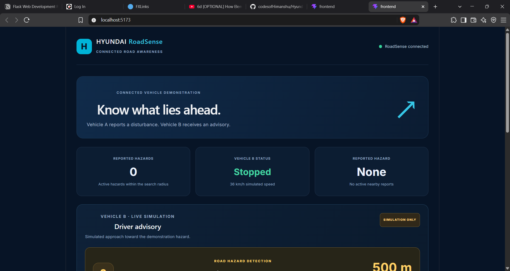
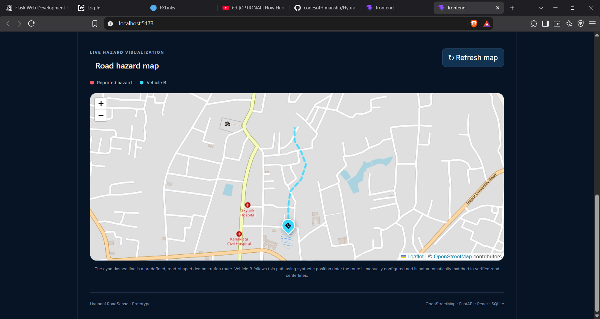
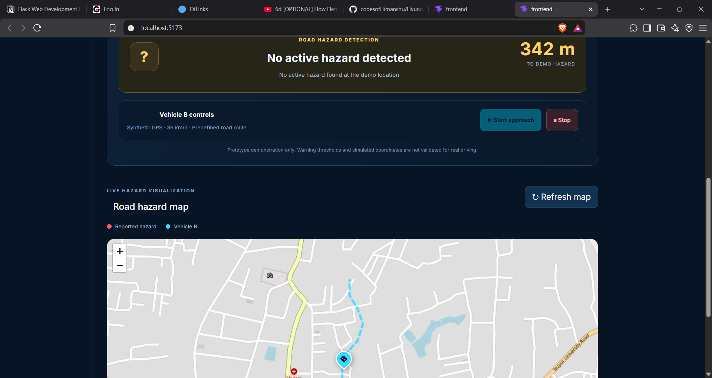

# Hyundai RoadSense 🚗

### Connected-Vehicle Road Hazard Detection and Warning Prototype

**Hyundai CoE Mobility Innovation Ideathon 2026 | Track B: AI-powered & Digital In-Vehicle Experience**

RoadSense is a student prototype that explores how vehicles can share road-hazard information with other connected vehicles. It uses machine learning to classify road disturbances, stores hazard reports through a backend, and displays warnings on a simulated connected-vehicle dashboard.

## 1. Problem Statement

Potholes, speed bumps and uneven road surfaces can create unexpected driving conditions.

Drivers may not receive timely information about these hazards, especially when approaching an unfamiliar road.

RoadSense explores a connected-vehicle approach where one vehicle reports a detected road disturbance and another approaching vehicle receives an advance warning.

## 2. Proposed Solution

RoadSense follows four main steps:

1. **Detect:** Analyse vehicle motion data to classify road disturbances.
2. **Report:** Send the hazard information to the backend.
3. **Validate:** Process and store hazard reports.
4. **Warn:** Display relevant warnings to another connected vehicle.

## 3. Key Features

* Machine-learning-based road disturbance classification.
* Classification of normal roads, potholes, bumps and uneven roads.
* FastAPI backend for prediction and hazard management.
* SQLite database for storing hazard reports.
* React-based dashboard.
* Simulated connected-vehicle movement and warning updates.
* API endpoints for hazard reporting and nearby hazard retrieval.

## 4. System Architecture

```text
Proposed Hardware Setup
ESP32 + MPU6050
       |
       v
Motion Sensor Data
       |
       v
Feature Extraction
       |
       v
Random Forest Classifier
       |
       v
FastAPI Backend
       |
       v
SQLite Database
       |
       v
Vehicle B Warning System
       |
       v
React Dashboard
```

**Prototype status:** The current demonstration uses synthetic sensor data for model testing and simulated vehicle movement. Live ESP32/MPU6050 integration has not yet been validated.

## 5. Machine Learning Model

RoadSense uses a Random Forest Classifier to classify road disturbances.

### Dataset Details

| Parameter          | Details                            |
| ------------------ | ---------------------------------- |
| Total samples      | 2,000                              |
| Classes            | Normal, Pothole, Bump, Uneven Road |
| Samples per class  | 500                                |
| Sampling frequency | 50 Hz                              |
| Window duration    | 2 seconds                          |
| Sensor axes        | 6                                  |
| Extracted features | 30                                 |

The dataset contains synthetic accelerometer and gyroscope readings.

### Model Evaluation

* Algorithm: Random Forest Classifier
* Number of trees: 200
* Training samples: 1,600
* Testing samples: 400
* Test accuracy: **94.75%**

**Important:** This accuracy was obtained using a held-out test set from the synthetic dataset. It does not represent validated real-world road-hazard detection accuracy.

## 6. Technology Stack

### Machine Learning and Backend

* Python
* NumPy
* Pandas
* Scikit-learn
* Joblib
* FastAPI
* Uvicorn
* SQLite

### Frontend

* React
* JavaScript
* Vite
* CSS

### Proposed Hardware

* ESP32
* MPU6050 accelerometer and gyroscope module

## 7. Project Structure

```text
Hyundai-RoadSense/
│
├── backend/
│   └── main.py
│
├── frontend/
│   ├── src/
│   └── package.json
│
├── ml/
│   ├── train_model.py
│   ├── predict.py
│   └── models/
│
├── simulation/
│   ├── generate_dataset.py
│   └── data/
│
├── requirements.txt
├── .gitignore
└── README.md
```

## 8. Installation and Setup

### Prerequisites

* Python 3.10 or later
* Node.js and npm
* Git

### Step 1: Clone the Repository

```bash
git clone https://github.com/codesofHimanshu/Hyundai-RoadSense.git
cd Hyundai-RoadSense
```

### Step 2: Set Up the Python Environment

```bash
python -m venv .venv
```

Activate the environment on Windows PowerShell:

```powershell
.\.venv\Scripts\Activate.ps1
```

Install the dependencies:

```bash
pip install -r requirements.txt
```

### Step 3: Start the Backend

From the project root:

```bash
python -m uvicorn backend.main:app --reload --host 127.0.0.1 --port 8000
```

Backend:

`http://127.0.0.1:8000`

API documentation:

`http://127.0.0.1:8000/docs`

### Step 4: Start the Frontend

Open another terminal:

```bash
cd frontend
npm install
npm run dev
```

Open the dashboard:

`http://localhost:5173/`

## 9. API Endpoints

| Method | Endpoint                          | Purpose                              |
| ------ | --------------------------------- | ------------------------------------ |
| GET    | `/`                               | Backend welcome endpoint             |
| GET    | `/health`                         | Health check                         |
| POST   | `/api/ai/predict`                 | AI prediction                        |
| POST   | `/api/ai/demo-predict`            | Demonstration prediction             |
| POST   | `/api/hazards`                    | Submit a hazard report               |
| GET    | `/api/hazards`                    | Retrieve hazard reports              |
| DELETE | `/api/hazards`                    | Delete hazard reports                |
| GET    | `/api/hazards/nearby`             | Retrieve nearby hazards              |
| POST   | `/api/simulation/vehicle-b/start` | Start Vehicle B simulation           |
| POST   | `/api/simulation/vehicle-b/stop`  | Stop Vehicle B simulation            |
| GET    | `/api/simulation/vehicle-b`       | Retrieve Vehicle B simulation status |

## 10. Current Limitations

* The machine-learning dataset is synthetic.
* Real-world model performance has not been established.
* Live ESP32 and MPU6050 integration is not yet validated.
* Vehicle movement and distance calculations are simulated.
* The current prototype is not connected to a production vehicle or live road network.

## 11. Future Improvements

* Integrate real-time ESP32 and MPU6050 sensor readings.
* Collect and validate real-world road-condition datasets.
* Improve model performance using real driving data.
* Integrate GPS-based hazard locations.
* Develop a cloud-based connected-vehicle communication system.
* Introduce hazard verification using reports from multiple vehicles.
* Explore integration with in-vehicle infotainment systems.

## 12. Project Objective

RoadSense aims to explore a smarter connected-mobility experience where vehicles can share road-condition information and help approaching drivers receive timely warnings.

**One vehicle detects. The next vehicle knows. Together, we move toward smarter, more informed journeys.**

---

**Project:** Hyundai RoadSense
**Track:** AI-powered & Digital In-Vehicle Experience
**Event:** Hyundai CoE Mobility Innovation Ideathon 2026


## 13. Dashboard Screenshots

### Dashboard Overview


### Road Hazard Map


### Vehicle B Simulation
